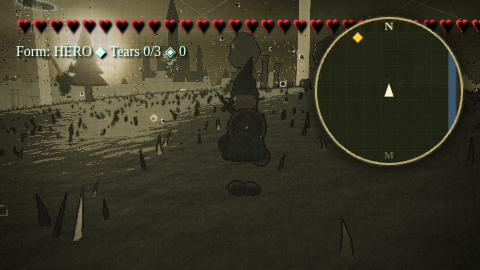
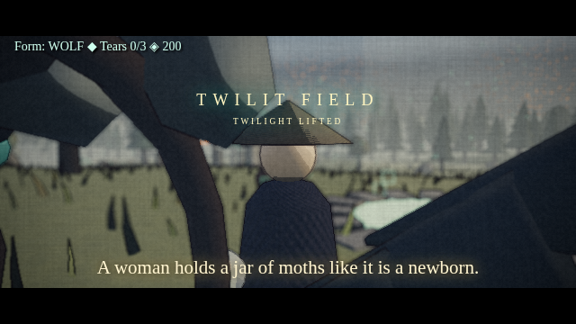
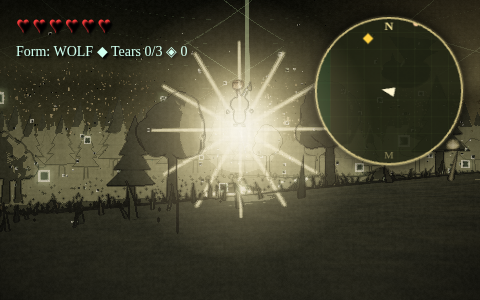
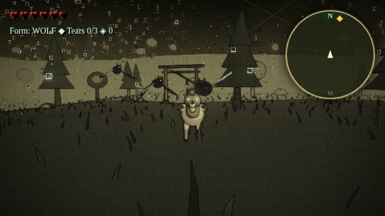

# Wolfie & Impie

A Twilight Princess– and Japanese-folklore-inspired action-adventure that runs in your browser. Roam a shadowed open world as a wolf, a sword-wielding hero, or a freed princess, with a mischievous Imp riding on Wolfie's back. Fight cyclical hordes that regenerate as you explore, bargain with odd merchants, follow your sword's light toward hidden goals, and step into a Yotsuya Kaidan haunted house. The art is ink outlines, flat shading and a limbless, Rayman-style character look.

## ▶️ [Play in browser](https://scaredofthe6ix.github.io/wolfie-impie/)

## Controls

| Input | Action |
|---|---|
| WASD | Move |
| Mouse drag | Camera |
| Left click / Space | Fast combo (attack mid-roll = dash strike) |
| Right click / K | Heavy strike (hold = charged spin) |
| J | Jump (jump then attack = plunge; near a locked foe = helm splitter) |
| C | Shield bash / parry |
| Z | Lock-on (locked Shift+A/D = side-hop) |
| Shift | Roll (hero) · dash (wolf) · blink (princess) |
| Tab | Wolf ⇄ human |
| 3 | Princess (once freed) |
| Q | Wolf senses |
| F | Dig / nova |
| R | Light orb |
| T (hold) | Sword light (guides you to your goal) |
| M | Map |
| L | Relics |
| H | Cool mode |
| N | Mute |

## Tech

- three.js (WebGL2), shipped as one self-contained HTML file that works offline
- Custom physics, combat, enemy AI and synthesized Web Audio
- No build step and no server

## Screenshots

## Status

**Work in progress.** This is an early, actively developed build, so expect rough edges, placeholder art and bugs.

## Credits

Built with [three.js](https://threejs.org/) (MIT License, © 2010–present three.js authors), which is bundled inside `index.html`.
